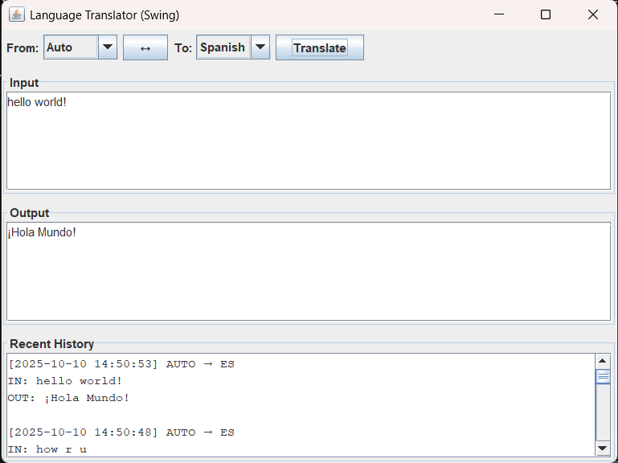

# Language-Translator

> A fast, online language translator built in pure Java. Supports multiple languages and online translation APIs. Includes a Swing GUI and CLI.

---

## UI Preview


---

## Features
- **Online Translation:** Uses APIs (Google, LibreTranslate, MyMemory)
- **Swing GUI:** User-friendly desktop interface for translation
- **CLI Tool:** Command-line translation for automation
- **History Tracking:** Stores translation history in SQLite
- **Multi-language Support:** English, Hindi, Arabic, Urdu, French, Spanish, German
- **Configurable:** Easily switch translation endpoints via `app.properties`

## Getting Started

### Prerequisites
- Java 17+
- Gradle (or use included `gradlew`)

### Build & Run
You can build and run the project easily using the provided batch script:

```sh
run.bat
```

Or use Gradle commands manually:
```sh
# Build the project
./gradlew build

# Run the Swing GUI
./gradlew run

# Or use the CLI
java -cp build/libs/Language-Translator-0.1.0.jar com.example.offlinetranslator.TranslateCli
```

### Configuration
Edit `src/main/resources/app.properties` to set:
- `translator.endpoint` (for online mode)
- `db.path` (SQLite DB location)

## Architecture
- **Main.java:** Entry point, loads config, starts GUI
- **TranslateCli.java:** CLI tool for translation
- **core/**: Language, request/result models, prompt templates
- **llm/**: Online translators
- **db/**: SQLite DB and history DAO
- **ui/**: Swing GUI components

## Supported Languages
- English (EN)
- Hindi (HI)
- Arabic (AR)
- Urdu (UR)
- French (FR)
- Spanish (ES)
- German (DE)

## Example Usage
```java
TranslationRequest req = new TranslationRequest(Language.EN, Language.ES, "Hello world");
TranslationResult res = translator.translate(req);
System.out.println(res.translated());
```

## Error Handling
The application keeps translation failures isolated from the UI flow and supports configurable endpoints. If an online provider is unavailable, check the configured endpoint and network connectivity before retrying.

## License
MIT License. See [LICENSE](LICENSE).

## Contributing
Pull requests welcome! For major changes, open an issue first to discuss what you would like to change.

---
